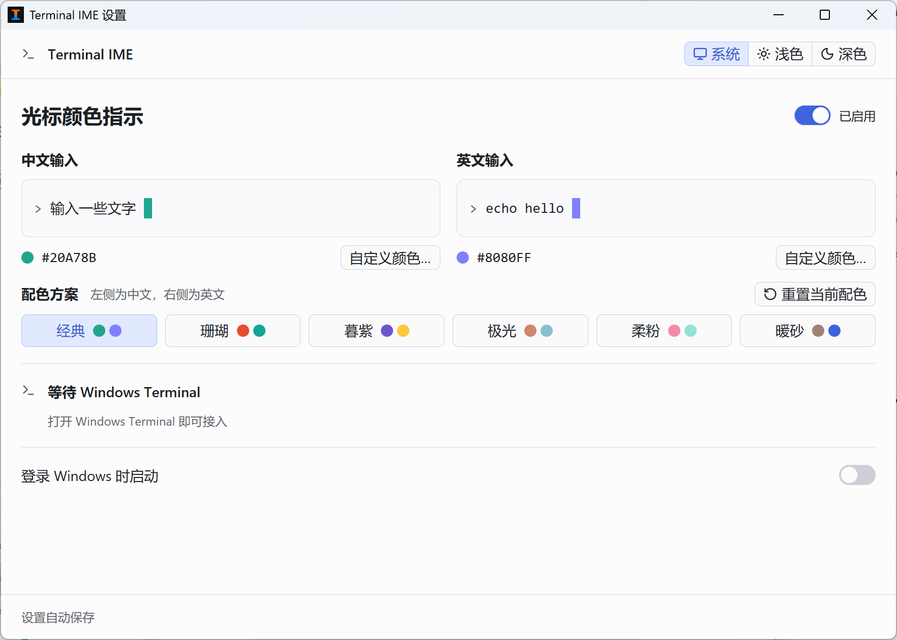

# Terminal IME

通过光标颜色区分 Windows Terminal 中的中文和英文输入，默认分别为橙色和蓝色。
程序自动接入终端，支持六组可编辑配色、明暗外观、托盘运行和登录启动。



## 构建并启动

需要 Windows、Windows Terminal、Rust 和 PowerShell 7。MSVC 工具链另需 C++ Build Tools 与 Windows SDK，GNU 工具链另需完整 GCC。

在项目根目录运行以下 Nushell 命令。

```nu
pwsh -NoProfile -File tools/build-desktop.ps1
./target/release/TerminalIME.exe
```

打开 Windows Terminal 后，程序自动接入已有和新建会话，无需修改 shell 配置。将 `TerminalIME.exe` 和后台组件 `terminal-ime.exe` 保留在同一目录。

需要便携目录时，运行 `pwsh -NoProfile -File tools/package-desktop.ps1`。输出位于 `artifacts/TerminalIME-portable/`。

## 调整设置

在设置窗口和托盘中完成日常操作。

- 选择配色方案，用 **自定义颜色** 分别修改中文和英文颜色。 **重置当前配色** 只重置选中的方案。
- 在右上角选择 **系统**、**浅色** 或 **深色** 外观。
- 开启 **登录 Windows 时启动**，登录后程序驻留托盘。
- 关闭设置窗口后程序继续运行。双击托盘图标打开设置，右键菜单可暂停、恢复或退出。
- 若提示管理员终端需要授权，点击 **以管理员身份重新启动**，再确认 Windows 授权提示。

配色、外观和窗口尺寸会自动保存，配置目录为 `%LOCALAPPDATA%\TerminalIME\`。

## 使用限制

同一 Windows Terminal 窗口中的分屏共用当前输入状态。窗口失去前台焦点或无法识别输入状态时，光标恢复终端主题色。

已验证微软拼音和美式英文键盘。其他输入法、WSL、SSH 和全部 TUI 的兼容性尚未全面验证。主动修改光标颜色的程序可能覆盖指示色。

## 进一步操作

- [独立 CLI 接入与诊断](docs/CLI.md)
- [桌面版验证记录](docs/DESKTOP_VALIDATION.md)
- [界面设计与验证记录](docs/GUI_REDESIGN.md)
- [原版 CLI 验证与性能数据](docs/VALIDATION.md)
